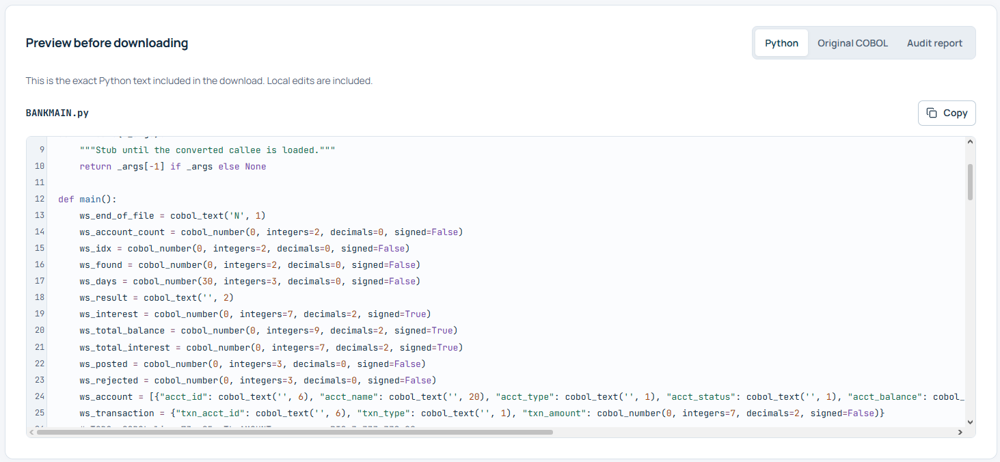

**Authors:** Spencer Peloquin, Justin Tendilla

# Export Page
Export lets users download generated `.py` files and review run history after conversion (and verification).

## Run history and export (requirements §3.1.11)
* Each analyze, convert, and verify step is saved as a run with time, status, and results.  
* Opening a project lists its saved runs; selecting a run shows full results.  
* Download each generated `.py` from a saved convert run (and from project-free conversion via its download id).

## Audit report (requirements §3.1.13)
* After convert and verify, show an audit report with each program’s verification status.  
* Show COBOL and Python output on numbered lines; mark differing lines.  
* Name each called program and the program that calls it.  
* Download as `audit-report.csv`.  
* Show “Convert this project before viewing the report.” when there is no verification result.  
* No audit report for batch-only conversion.

## Design presentation
Export = Download + history. Project mode lists conversion runs; batch mode uses its download ID.

## Where this appears in the app

Export opens at `/export?project=`.

* **Back to Convert** and the **Reading guide**.
* A notice when this tab has local Python edits: the `.py` download includes those edits, and the audit report still describes the saved draft.
* **Downloads**, with **Preview** and **Download .py** for each file, and **Download .csv** for `audit-report.csv` after verification. The procedure is [[Download Generated Python|Download-Generated-Python]].
* **Preview before downloading**, switched among **Python**, **Original COBOL**, and **Audit report**.
* **Run history** for analyze, convert, verify, and AI review, with status and time.

*Figure 1. Export with a Python file selected.*

The **Audit report** switch in that preview shows the same report as Figure 2 on the [[Convert Page|Convert-Page]].
